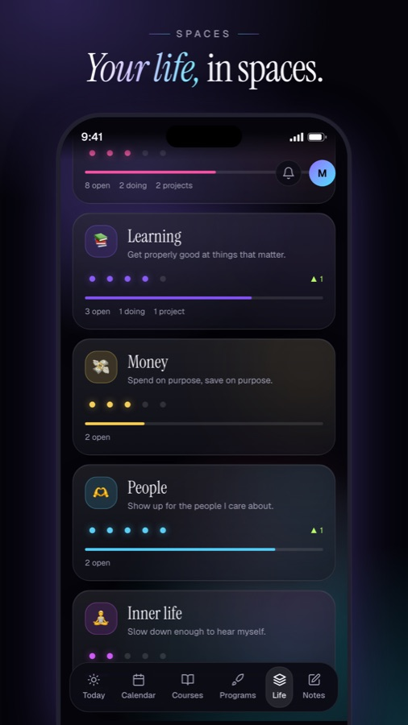

# Orbit

A personal dashboard for Mesa students. Your classes, deadlines, calendar and the rest of your life, in one place that is yours.

[](docs/orbit-demo.mp4)

**[Watch the 60-second demo](docs/orbit-demo.mp4)** (all data in it is made up).

> Unofficial. Not made by, or affiliated with, Mesa School of Business.

## What you get

- **Today.** Your timeline, free windows, what's live now, deadlines and tasks.
- **Calendar.** Classes from Nexus plus your Google calendars in one week or month view, with optional two-way sync to Google Calendar.
- **Courses and attendance.** Deadlines per course, and your attendance against the 75% rule: how many classes you can still miss.
- **Life.** Spaces (health, learning, the startup, people…) holding projects and tasks, with list and board views, a planner, daily mood and energy check-ins, a weekly review, plus habits, goals and a money log.
- **Notes.** Turn a class transcript (Wispr Flow, or anything you paste in) into clean study notes, filed under the right course.
- **Inbox.** Push notifications for deadlines, your own reminders and new Nexus announcements.

## Your data stays yours

There is no shared Orbit server and no account with the author. **You run your own copy**, with your own database, your own Nexus token and your own Google sign-in. Nobody else, including whoever shared this with you, can see your data.

Please keep it that way: don't put another student's Nexus token into your deployment, and don't share your deployment's address. Your Nexus token can read your grades and attendance, so treat it like a password.

## What you need

All of these have a free tier that is enough for one person.

| You need | For |
|---|---|
| A Nexus token | Classes, deadlines, announcements, attendance |
| A [Supabase](https://supabase.com) project | Your database and Google sign-in |
| A [Vercel](https://vercel.com) account | Hosting (or run it on your laptop) |
| A Google Cloud project | Sign-in, and optional Calendar sync |
| *Optional:* Wispr Flow, and a Gemini or OpenRouter key | Class notes |

**Not technical? Start with [START-HERE.md](START-HERE.md).** It is click-by-click, with no commands, and takes 30 to 45 minutes. Comfortable with a terminal? [SETUP.md](SETUP.md) is the full version, including optional notifications, Calendar sync and notes.

## Run it on your laptop

```bash
git clone <this repo> orbit && cd orbit
npm install
cp .env.example .env.local     # then fill it in, see SETUP.md
npm run dev                    # http://localhost:3000
npm run preflight              # checks your setup and every service before you deploy
npm test
```

Until Supabase keys are set, local development stays open so you can click around.

## Built with

Next.js 16 (App Router, Cache Components), React 19, Tailwind CSS 4, Supabase (Postgres with row-level security, Auth), Web Push, and the Nexus MCP endpoint. Nothing is stored outside your own Supabase project.

## Make it yours

- **Another note source.** Notes accept any pasted transcript, so exports from Granola or any other recorder work by pasting them into **Notes → New**. A built-in Granola connection isn't included. Wispr Flow's connection in `lib/wispr` is a good template if you want to add one.
- **Spaces, check-in wording and review questions** live in `lib/life/spaces.ts` and `components/life`.
- **Design tokens** are at the top of `app/globals.css`.

## Troubleshooting

- **"Can't reach Nexus"**: the token is wrong or expired. Make a new one in Nexus → Nexus MCP, and tick the permissions listed in SETUP.md.
- **Sign-in bounces you back**: the address you signed in with isn't `ALLOWED_EMAIL`.
- **Life says "One more step"**: run the SQL files in `supabase/migrations` in order.
- **Google keeps asking you to reconnect**: your Google consent screen is in *Testing* mode, which expires tokens weekly. Publish it (SETUP.md explains).
- **No notifications on iPhone**: add the app to the Home Screen first, then open it from there.

## Contributing

Issues and pull requests are welcome. Run `npm test` and `npm run lint` before you open one.

## Licence

MIT. See [LICENSE](LICENSE).
